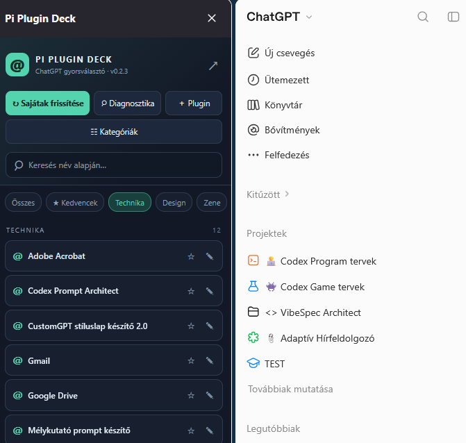

# 🦊 Pi Plugin Deck

**Kategorizálható ChatGPT-pluginindító a Firefox oldalsávjában.** Válaszd ki a plugint egy saját, rendezhető listából, a Deck pedig beilleszti a `@Plugin neve` hivatkozást a ChatGPT beszélgetésébe.

> **Állapot:** v0.2.3. Közösségi, független Firefox-bővítmény. Nem hivatalos OpenAI- vagy Mozilla-termék. A ChatGPT felületének változásai befolyásolhatják a működést.

## Mire jó?

- **Gyors @-indítás:** kattintás a plugin nevén, és a Deck beírja a teljes `@`-os nevet a ChatGPT szerkesztőjébe. A ChatGPT találatlistájából megpróbálja kiválasztani a tényleges plugint is.
- **Saját kategóriák:** például *Technika*, *Design*, *Zene*. A pluginokat manuálisan rendezheted.
- **Kedvencek, keresés és névszerkesztés:** gyors elérés sok plugin esetén is.
- **↻ Sajátak frissítése:** a ChatGPT `Te hoztad létre / Created by you` oldalán **látható** saját pluginok nevét próbálja kiolvasni. A találatokat jóváhagyás után veszi fel.
- **Diagnosztika:** oldalszerkezet-változás esetén ellenőrzésre alkalmas, kézzel másolható hibajelentést készít.
- **JSON export/import:** a helyi beállítások és kategóriák mentése, visszaállítása.

## Telepítés

### Fejlesztői teszt Firefoxban

1. Töltsd le a projekt forrását GitHubról **Code → Download ZIP**, majd csomagold ki.
2. Nyisd meg Firefoxban: `about:debugging#/runtime/this-firefox`.
3. Kattints a **Load Temporary Add-on / Ideiglenes kiegészítő betöltése** gombra.
4. Válaszd ki a kicsomagolt `manifest.json` fájlt.
5. Nyisd meg a ChatGPT-t; a Firefox oldalsávját szükség esetén állítsd a jobb oldalra.

**Fontos:** ez csak ideiglenes betöltés; a Firefox újraindításakor megszűnik. A normál, tartós telepítéshez a Mozilla által **aláírt `.xpi`** szükséges. A forrás ZIP nem aláírt telepítő. A saját használatra szánt aláíráshoz a Mozilla *Unlisted (On your own)* terjesztési módja használható. Lásd: [Telepítési útmutató](INSTALL.md).

## Használat

1. Nyisd meg a [ChatGPT-t](https://chatgpt.com/), és jelentkezz be a saját fiókodba.
2. Nyisd meg a **Pi Plugin Deck** oldalsávot.
3. Ha a saját pluginjaidat szeretnéd beolvasni, nyisd meg a [Saját készítésű pluginok](https://chatgpt.com/plugins?directoryTab=personal&category=plugins-created-by-you) oldalt, majd a Deckben kattints a **↻ Sajátak frissítése** gombra. Ellenőrizd a felajánlott neveket.
4. Hozz létre kategóriákat, vagy jelöld kedvencnek a gyakran használt pluginokat.
5. Nyiss meg egy beszélgetést, és kattints a kívánt plugin nevére.

**A beillesztés nem azonos a plugin biztos aktiválásával.** Ha a ChatGPT nem választotta ki automatikusan a megfelelő `@`-találatot, válaszd ki manuálisan a saját találatlistájából. A bővítmény nem küld el automatikusan üzenetet.

## Adatkezelés és jogosultságok

A Deck a `chatgpt.com` oldalon megjelenő felületi adatokat olvassa, és a mentett listát a Firefox `browser.storage.local` tárolójában tartja. Nem használ külön távoli API-t, és a kód nem tartalmaz külső szerverre adatokat küldő funkciót. A JSON export és a diagnosztika **a felhasználó külön művelete**; megosztás előtt ellenőrizd a tartalmukat.

A Firefox `storage`, `tabs`, `clipboardWrite` engedélyeit és a `https://chatgpt.com/*` oldalhozzáférést kéri. A működés a ChatGPT oldalának DOM-szerkezetétől függ; a frissítés nem a ChatGPT belső, nem dokumentált API-ját használja.

## Fejlesztés és közreműködés

Szívesen fogadunk hibajelentéseket, ötleteket és javításokat: [CONTRIBUTING.md](CONTRIBUTING.md). A projekt forrása szabadon felhasználható és továbbfejleszthető **MIT-licenc** alapján, az eredeti szerzői jogi és licencmegjegyzés megtartásával. Részletek: [LICENSE](LICENSE).

**Szerző / projektgazda:** CyberMacs (Pi). **Nem hivatalos ChatGPT-integráció.** A ChatGPT és Firefox megnevezések és védjegyek tulajdonosaikhoz tartoznak.

## Verziók

Lásd: [CHANGELOG.md](CHANGELOG.md).